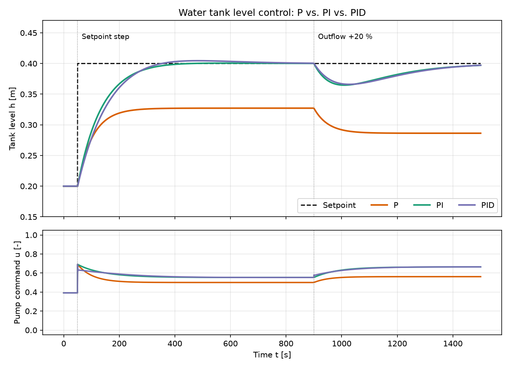

# Tank Level Control – P vs. PI vs. PID

Python simulation of a water tank level control loop. A nonlinear tank model (Torricelli outflow) is controlled by P, PI and PID controllers. The scenario contains a setpoint step and an outflow disturbance, so the typical controller trade-offs become visible.



## What is simulated?

**Plant:** a tank with a pump at the inlet and a free outflow at the bottom.

```
A · dh/dt = k_pump · u − c · √h · leak
```

| Symbol | Meaning | Value |
|---|---|---|
| A | Tank cross-section | 0.5 m² |
| k_pump | Inflow at full pump command | 0.004 m³/s |
| c | Outflow coefficient | 0.0035 m²·⁵/s |
| u | Pump command (limited to 0…1) | – |

**Scenario**

1. Start in steady state at h = 0.20 m
2. t = 50 s: setpoint step to 0.40 m
3. t = 900 s: disturbance, outflow +20 % (e.g. an open drain valve)

**Controllers**

| Controller | Kp | Ti | Td |
|---|---|---|---|
| P | 1.5 | – | – |
| PI | 1.5 | 150 s | – |
| PID | 1.5 | 150 s | 20 s |

Implementation details: output limit 0…1, anti-windup (integrator is frozen while the output saturates), derivative acts on the measurement (no kick at the setpoint step).

## Results

| Controller | Overshoot | Rise time (10–90 %) | Settling time (2 %) | Steady-state error | Level drop at disturbance |
|---|---|---|---|---|---|
| P | 0 % | not reached | not reached | 0.073 m | 0.114 m |
| PI | 0.3 % | 181 s | 298 s | ≈ 0 m | 0.035 m |
| PID | 2.3 % | 187 s | 506 s | ≈ 0 m | 0.034 m |

**Findings**

- **P** is simple but leaves a permanent control error, and the error grows when the disturbance hits.
- **PI** removes the steady-state error completely and recovers from the disturbance.
- **PID**: on this slow, first-order-like plant the derivative term adds almost no benefit. It slightly increases overshoot and settling time. The D part pays off on plants with more lag or oscillation, not here.

## Getting started

```bash
git clone https://github.com/Nicktedie123/tank-level-control.git
cd tank-level-control

python -m venv .venv
# Windows (Git Bash):  source .venv/Scripts/activate
# Linux / macOS:       source .venv/bin/activate

pip install -r requirements.txt
python src/tank_control.py
```

The script prints a metrics table and writes `results/step_response.png` and `results/metrics.csv`.

Run the tests:

```bash
python -m pytest
```

## Project structure

```
tank-level-control/
├── src/tank_control.py     # model, PID controller, simulation, plots
├── tests/test_tank.py      # sanity tests
├── results/                # generated plot and metrics
├── requirements.txt
├── .gitignore
├── LICENSE
└── README.md
```

## Ideas for extension

- Controller tuning with Ziegler-Nichols or Lambda tuning
- Measurement noise and a sensor filter
- Two coupled tanks (cascade control)
- Interactive parameters with a small GUI

## Limitations

Simplified model: Euler integration with a fixed step, no pump dynamics, no sensor noise. Intended for learning and demonstration.

## License

MIT, see [LICENSE](LICENSE).
